<!-- ============================================================
     Dark-knight theme  ·  cinematic stormy night  ·  artwork lives in /assets
     edit & rebuild the SVGs with:  python tools/build_assets.py
     ============================================================ -->

 

<!-- ===================== ABOUT ===================== -->

  

<table align="center">
<tr>
<td width="42%" align="center" valign="middle">

</td>
<td width="58%" valign="middle">

<!-- ✏️ Edit your info below. Hidden lines at the bottom: move one above this note's end marker to show it. -->

### 🦇 Hello, World!

I'm **Paphop** — a **Full-Stack Developer** from **Thailand** 🇹🇭

- 👤 &nbsp;**Name:** Paphop Surathip
- 🎓 &nbsp;**Education:** Computer Science student
- 📍 &nbsp;**Location:** Thailand
- 💼 &nbsp;**Role:** Full-Stack Developer
- 🗣️ &nbsp;**Languages:** Thai · English
- ☕ &nbsp;**Fuel:** Black coffee & late nights
<!-- hidden — copy a line above (without this comment) and fill it in:
- 🔭 &nbsp;**Working on:** ...
- 🏫 &nbsp;**University:** ...
-->

</td>
</tr>
</table>

<!-- ===================== TECH STACK ===================== -->

  

<table>
<tr>
<td align="center" width="50%">

**🦇 Frontend**

**⚡ Backend**

</td>
<td align="center" width="50%">

**🗄️ Database**

**🛠️ Tools & DevOps**

</td>
</tr>
</table>

<!-- ===================== FUN FACTS ===================== -->

  

<table align="center">
<tr>
<td>

- ☕ &nbsp;Black coffee is my main fuel
- 🌙 &nbsp;My best code ships after midnight
- 🦇 &nbsp;Dark mode, always — the light hurts my eyes
- 🐛 &nbsp;I hunt bugs in the dark

</td>
</tr>
</table>

<!-- ===================== FOOTER ===================== -->

🦇 forged in the dark with code & black coffee ☕

